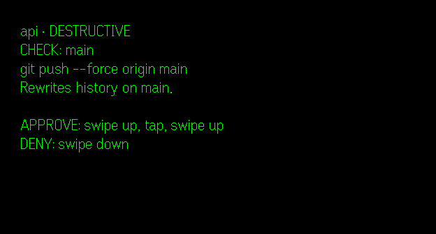

# Breakpoint

I leave Claude Code running while I step away, and I often come back to find it stopped on a permission prompt, waiting for me the whole time.

The opposite worries me more. Anthropic reports that people approve about 97% of Claude Code's permission prompts. When everything gets a yes, the one prompt that deserved a no gets a yes too. And now that auto mode handles the routine ones, what still reaches a person is the hard part: actions the classifier blocked, your own `ask` rules, and plans you want to judge before any code gets written.

So I'm putting those prompts on my Even G2 glasses, and making the dangerous ones hard to approve without reading them.



*A force push to main, as it appears in the Even Hub simulator. The approve gesture changes every time.*

**Demo video:** link coming with the submission.

**Claude Code asks for permission or proposes a plan, it shows up on your glasses, and you answer with a gesture.** Safe things wait until you're not busy. Destructive things interrupt you right away, and approving one takes a gesture you have to read off the card.

No AI decides anything on your approvals. Rules classify, you decide.

> Early days: this is being built during the Heads Up hackathon (Even Realities, 23 to 29 Nov 2026). The parts marked *working* below run today, tested in the Even Hub simulator rather than on real glasses so far. Everything else is on the way, and this README changes as it lands.

## What it does

- **Answers Claude Code from your glasses.** *(working)* Claude Code runs Breakpoint's hook whenever it's about to ask you something. The request travels through a small relay to the glasses, where a tap allows it and a swipe down denies it. The terminal dialog stays open too, so whichever answer comes first wins and you can always answer at your desk.
- **Works from anywhere.** *(working)* Laptop and glasses don't need to be on the same network. They meet at a relay you pair with once, using a 6-digit code.
- **Deny talks back.** *(working)* Swiping down opens three short replies picked for the command, like "Use a new branch instead" for a force push or "List what would be deleted first" for `rm -rf`. Tap one and Claude takes that route instead of stalling. Double tap in that list denies without a reply, so a stray double tap fails safe.
- **Approves plans.** *(working)* When Claude finishes a plan in plan mode, the glasses show its title and first three steps. Tap to approve and Claude starts building. Swipe down to send feedback like "Smaller first" or "Tests first", and Claude revises the plan and asks again. Anthropic reports people reject 39% of plans but only 3% of individual permission requests, so plans are where your judgement gets used most. The summary is pulled from Claude's own plan by plain code, not rewritten by a model.
- **Knows when you answered at the desk.** *(working)* Answer in the terminal and the card on your glasses clears itself.
- **Sorts every request by risk.** *(working)* Plain rules, not a model, decide the tier. They're covered by over 100 test cases, including look-alikes such as `echo "rm -rf /"` that must stay safe:

  | Tier | For example | When it shows | To approve |
  | --- | --- | --- | --- |
  | Destructive | `rm -r`, `git push --force`, `git reset --hard`, `curl … \| sh`, writing `.env` or keys, publish and deploy | Right away | A gesture sequence that changes every time, like "swipe up, then tap" |
  | Outside effects | `git push`, installing packages, network calls, writing outside the project | At your next break, within 60 s | Tap |
  | Local | Edits inside the project, running tests | Batched at your next break, within 4 minutes | Long press approves the batch |

  Saying no is always the same: swipe down. A wrong approve gesture switches to a different sequence, so approving a destructive command can't become muscle memory.
- **Waits for a natural break.** *(working in the simulator with a busy toggle; voice and motion detection are built and unit-tested but not yet tried on real glasses)* If someone is talking near you or you're moving, non-urgent requests wait. Destructive ones still interrupt, outside-effect ones wait at most a minute, and local ones at most four minutes, so a trivial edit never stalls Claude through a long meeting. How loud the microphone is gets worked out on your phone, and the audio itself never leaves it. This is a simple, rule-based take on attention-sensitive alerting, not a model of your attention.
- **Telegram as a second surface.** *(working)* If the glasses app has been closed for 20 seconds, requests go to your Telegram instead, and a destructive request nobody answers on the glasses within 3 minutes goes there too. The first answer wins and the other copy updates itself. Normal requests get Allow, the same canned replies and Deny as buttons. Destructive ones get no Allow button: you approve by sending the word the message shows, such as the branch name. Every destructive decision posts a receipt to your chat, or to a channel you pick. Only the Telegram account you linked can answer.

## Try what works today

You need [Bun](https://bun.sh), Claude Code, [cloudflared](https://developers.cloudflare.com/cloudflare-one/connections/connect-networks/downloads/) and the Even Hub simulator (`npm i -g @evenrealities/evenhub-simulator`).

```bash
git clone https://github.com/Sammy949/breakpoint
cd breakpoint && bun install
(cd relay && bun install) && (cd glasses && bun install)
```

**1. Run the relay.** It's a Cloudflare Worker, and it runs locally without an account. A quick tunnel gives it a public URL:

```bash
cd relay && bun run dev
cloudflared tunnel --url http://localhost:8787   # prints https://<random>.trycloudflare.com
```

**2. Pair.** On the laptop:

```bash
bun scripts/pair.ts https://<random>.trycloudflare.com
```

It prints a 6-digit code. Start the glasses app and open it in the simulator, passing the relay URL and the code (on a phone you'd type them into the Breakpoint screen instead):

```bash
cd glasses && bun run dev
evenhub-simulator "http://localhost:5180/?relay=https://<random>.trycloudflare.com&code=<code>"
```

**3. Add the hooks to a project.**

```bash
bun scripts/setup.ts /path/to/your/project --ask
```

This writes Breakpoint's hooks into the project's `.claude/settings.local.json`, which stays on your machine. `--ask` also adds `ask` rules for risky commands (`rm`, `git push`, `npm install` and a few more) so they prompt even in auto mode. Start Claude Code in that project and ask it to run `rm -rf some-folder`. The card appears in the simulator.

**Or let the demo script do it.** `scripts/demo.sh` wraps all of this: `pair`, `sim <code>`, `telegram`, and `project`, which builds a throwaway project whose "origin" is a local bare repo, so the force push never leaves your machine. Then `demo.sh claude <scene>` starts Claude Code in tmux with a prompt that triggers one kind of request (`batch`, `install`, `force-push`, `delete` or `plan`). `demo.sh cards <scene>` posts the same requests without Claude, which costs nothing and is good for rehearsing.

To check the relay on its own, `bun scripts/relay-smoke.ts <relay-url>` plays both laptop and glasses and runs through pairing, verdicts and isolation between laptops.

### Telegram (optional)

Create a bot with [@BotFather](https://t.me/BotFather) and put its token in `.env` as `TELEGRAM_BOT_TOKEN` (see `.env.example`). Then, with the relay running:

```bash
bun scripts/telegram.ts webhook https://<your-relay-url>   # points the bot at the relay
bun scripts/telegram.ts link                                # prints a link: open it on your phone and tap Start
```

For a local relay, `webhook` also writes the token to `relay/.dev.vars` (gitignored), so restart `bun run dev` after it. Telegram has to reach the relay, so a local one needs the quick tunnel.

### Deploying your own relay

A quick tunnel's URL changes every run. For a lasting one, deploy the relay to your own Cloudflare account:

```bash
cd relay && bun run deploy
```

Pair against the `workers.dev` URL it prints. For Telegram, also run `bunx wrangler secret put TELEGRAM_BOT_TOKEN` in `relay/`. To install the app on real glasses, put that URL in `glasses/.env` as `VITE_BREAKPOINT_RELAY` (see `.env.example`) and run `bun run pack` in `glasses/`, which adds the relay to the app's network allowlist. A relay for judges will be linked from the submission page.

## Privacy

- No account, no telemetry, no analytics.
- The relay passes messages between your laptop and your phone. Waiting requests are held in memory and never written to disk. Without Telegram, the only thing it stores is a hash of your glasses' pairing token.
- Only a one-line preview of the command or file path, Claude's description of it, and the project folder name leave the laptop. For plans, that's the title and up to three steps. The relay strips control characters and caps their length before they reach the glasses.
- **If you link Telegram,** each request sent there and each destructive receipt (the same preview, session name and outcome) passes through Telegram's servers. The relay stores your Telegram user ID, chat ID and receipt channel, if you set one, to know where to send them and whose answers count. `/stop` deletes them.
- Your laptop's relay token is saved in `~/.config/breakpoint/config.json`, outside the repo.

## Why hooks and not channels

Claude Code has a research-preview feature called channels, which can also relay permission prompts. I built that first (`channel/server.ts`, adapted from the [channels reference](https://code.claude.com/docs/en/channels-reference)) and it works at the protocol level. But organisations have to switch channels on, and the development flag doesn't get around that, so anyone on a company account would hit a wall.

[Permission hooks](https://code.claude.com/docs/en/hooks) are a stable, documented part of Claude Code. They work on any account, see the full command instead of a shortened preview, and need one settings entry instead of a startup flag.

## Next

- **Tell your own voice from a meeting around you.** The glasses tag each audio frame as you, someone else or unknown. That could separate "I'm talking" from "a conversation is happening near me", which deserve different waits.
- **Team policies:** shared rules for which commands count as destructive, and receipts to a team channel.

## Limitations

- **Tested in the Even Hub simulator, not yet on G2 hardware.** The app's network allowlist lists the relay under both `https://` and `wss://`, because the docs don't say whether WebSockets need their own entry. That's unproven on a real device.
- **The glasses app only works while it's open.** Even Hub plugins can't run in the background, so a closed app can't show a card. The terminal dialog still works, and requests fall back to Telegram if you've linked it.
- **Waiting requests live in the relay's memory.** If Cloudflare restarts it, they're lost. The hook then steps aside and the terminal dialog decides, so nothing is approved by accident.
- **Requests don't wait forever.** If nobody answers within 29 minutes, the hook withdraws the card and steps aside, and the terminal dialog decides. `setup.ts` sets Claude Code's hook timeout to 30 minutes and the hook's own deadline a minute earlier, so the hook always ends on its own terms.
- **Pairing is rate-limited globally,** not per person, so someone guessing codes could block new pairings for a minute.

## A Claude Code quirk worth knowing

Approving a plan from a hook doesn't work the obvious way. A `PermissionRequest` hook that returns `allow` for `ExitPlanMode` leaves the plan dialog open, and so does an allow that also switches the permission mode. The dialog only closes when the hook echoes the plan back unchanged as `updatedInput`. Breakpoint does that for plans only. Tool calls keep a plain allow, because updated input is checked against your `ask` rules again and could prompt a second time. Tested on Claude Code v2.1.332. It isn't in the docs, but it is known: [issue #90498](https://github.com/anthropics/claude-code/issues/90498) reports the same thing, and [Plannotator](https://github.com/backnotprop/plannotator) echoes the plan for the same reason. It's in [FEATURE_REQUESTS.md](FEATURE_REQUESTS.md).

**Prior art:** Plannotator reviews plans in a browser using the same `PermissionRequest` hook. Breakpoint does it on the glasses, for when you're away from the desk, and covers tool permissions as well as plans.

## Before building it

Three bits of research shaped the design. It's *informed by* them, not a replication.

- **Interrupt at breaks.** Iqbal and Bailey found that interruptions at natural breaks in a task cost about the same as no interruption at all, while interruptions mid-task slow people down and frustrate them. Hence the name.
- **Weigh the cost of waiting against the cost of interrupting.** Horvitz, Jacobs and Hovel's attention-sensitive alerting work at Microsoft Research inferred whether someone was busy from signals including nearby conversation. Breakpoint's scheduler is a much simpler, rule-based version of that idea.
- **Warnings that change resist habituation.** Anderson, Vance and colleagues at BYU showed attention to repeated warnings drops sharply, and that warnings which change their appearance hold attention for weeks. That's why the destructive-tier gesture changes every time.

## What existed before the hackathon

Everything here was written during the build window. The starting points from elsewhere:

- `glasses/` began as the official [Even Hub minimal template](https://github.com/even-realities/evenhub-templates). It's committed unmodified first, so the history shows exactly what changed.
- `channel/server.ts` is adapted from the permission-relay example in the Claude Code channels docs.
- The open-source libraries listed under Credits.

## Credits

Built on the [Even Hub SDK](https://hub.evenrealities.com/docs) and template, the [Model Context Protocol SDK](https://github.com/modelcontextprotocol/typescript-sdk), [zod](https://github.com/colinhacks/zod), [Vite](https://github.com/vitejs/vite) and TypeScript.

Not affiliated with Anthropic or Even Realities.

## License

[MIT](LICENSE)
